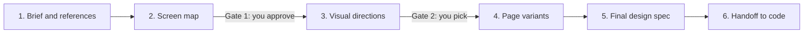

# app-design-spec

An [Agent Skill](https://agentskills.io) that helps a coding agent design an
app's screens with you, iPhone first. It goes from a short brief and the apps
you like to a single HTML design spec: every screen in every state inside an
iPhone frame, with colour and type tokens, voice rules, implementation notes
and an inspect mode. You approve the screen list and pick the look on the way;
the agent picks page layouts and says why. When the app already exists, the
agent reads its code for the real screens, data and copy, and ends with a
handoff that maps each screen to code.

## The flow



1. **Brief and references.** A few questions, plus screenshots, links or App
   Store names of apps you like. The agent notes what to borrow from each.
2. **Screen map.** Every screen and every state (empty, loading, error,
   offline, first run, permission, large text). You approve it.
3. **Visual directions.** 3 or 4 looks on the same key screens, in one HTML
   file. You pick one, or two to mix.
4. **Page variants.** 2 or 3 layouts for the most important screens. The agent
   picks and explains; you can override.
5. **Design spec.** One self-contained HTML file with every screen and state.
6. **Handoff.** Screen-to-code mapping and build tasks, then a screenshot
   comparison of the real app against the spec.

Every deliverable is one HTML file with no external links. It opens offline in
any browser and can be sent as an attachment.

## What's inside

```
skills/app-design-spec/
  SKILL.md              the workflow the agent follows
  references/           one short guide per step, plus iPhone rules and checks
  assets/shell.html     the shared HTML shell (frames, sidebar, inspect, save)
  assets/example-app/   a complete fictional example and starting point
  scripts/build.py      inlines a project's files into the shell -> one HTML file
  scripts/check.py      renders every phone in Chromium and checks it
```

`check.py` looks for console errors, network requests, clipped text, content
running off the screen, buttons under the status bar or home indicator, low
contrast, and breakage at larger text sizes. It saves a screenshot of every
phone.

## Install

Copy the `skills/app-design-spec` folder into your agent's skills folder. For
Claude Code that is `~/.claude/skills/`:

```sh
git clone https://github.com/themartianapp/app-design-spec
mkdir -p ~/.claude/skills
cp -r app-design-spec/skills/app-design-spec ~/.claude/skills/
```

Other clients that support Agent Skills load the same folder; check your
client's documentation for where it looks for skills.

Then ask your agent something like "design the screens for my app" or
"redesign this iOS app".

## Requirements

- Python 3.10 or newer for `build.py` (standard library only).
- [uv](https://docs.astral.sh/uv/) to run `check.py`; it installs
  Playwright from the script's inline metadata. Chromium must be installed
  once: `uv run --with playwright playwright install chromium`.
  Without uv: `pip install playwright && playwright install chromium`.

## Quick start with the example

From the repository root:

```sh
python3 skills/app-design-spec/scripts/build.py skills/app-design-spec/assets/example-app --entry app.js -o out/example-spec.html
uv run skills/app-design-spec/scripts/check.py out/example-spec.html

python3 skills/app-design-spec/scripts/build.py skills/app-design-spec/assets/example-app --entry proposals.js -o out/example-proposals.html
uv run skills/app-design-spec/scripts/check.py out/example-proposals.html
```

Open the HTML files in a browser. Screenshots and the check report are in
`out/example-spec-check/` and `out/example-proposals-check/`.

## Validate the skill

```sh
uvx --from skills-ref agentskills validate skills/app-design-spec
```

## License

[Apache-2.0](LICENSE).
