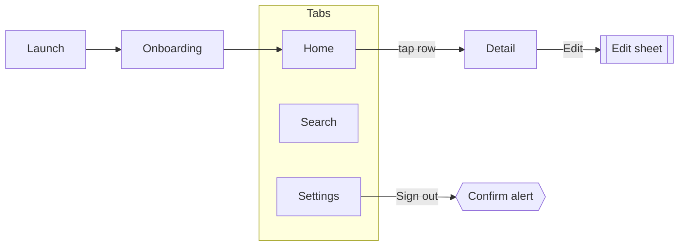

# Step 2: Screen map (Gate 1)

The screen map lists every screen and every state before any visual work. It
is cheap to change now and expensive to change later.

## Format

Save as `design/screen-map.md`.

```md
# <App name>: screen map

## Screens
| # | Screen | Purpose | Reached from | States |
| --- | --- | --- | --- | --- |
| 01 | Home | See today's items at a glance | App launch, Home tab | normal, empty, loading, offline (new) |
| 02 | Item detail | Read and edit one item | Tap a row on Home | normal, error |
| 03 | Settings | Account and preferences | Settings tab | normal |
| 04 | Widget setup [iOS] | Add the home screen widget | Settings | normal |

## Applies to every screen
- Large text: every screen is checked at a large Dynamic Type size.
- (other rules that hold everywhere, once)

## Navigation
(diagram, see below)

## States not needed
- Settings / empty: always has content.
- ...

## Pending decisions
- (question for the user) · Draft: "(the wording or behaviour you propose)"

## Open questions
- ...
```

Rules:

- One row per screen. A sheet or a full-screen alert that has its own layout
  is a screen. A small system alert is a state of the screen behind it.
- Number screens in the order a new user meets them. These numbers appear in
  the spec sidebar ("01 / 12").
- Purpose is one sentence from the user's side, not the code's.
- Rules that hold for every screen (large text, dark mode only, right-to-left
  support) go once under "Applies to every screen", not in every row.
- **States you propose that the code does not have yet:** mark them `(new)`.
  Gate 1 then approves them explicitly, and the handoff lists them as new work.
  Only an existing app needs this marker.
- **Code paths:** if the app exists, keep the table short. Add a `Code` column
  with one file per screen, or put the full screen-to-file list in
  `design/existing-app-notes.md` and link it.

## More than one platform

The skill designs iPhone first. If the app also ships on Android (or iPad):

- Keep one screen map. Mark screens or states that exist on one platform only
  with `[iOS]` or `[Android]`, as in row 04 above.
- Say once, under "Applies to every screen", how the other platform is
  handled. Usually: the iPhone design is the reference, and the Android build
  adapts system parts (navigation bar, back button, sheets, dialogs, fonts) to
  Android conventions without its own spec.
- If a screen must look truly different on the other platform, list it as its
  own row with the platform marker, and ask at Gate 1 whether it needs its own
  phone frames in the spec.

## States checklist

Go through every screen with this list. Keep the states that apply; for the
rest write one line saying why not.

| State | Ask yourself |
| --- | --- |
| **Normal** | What does it look like with typical, real data? |
| **Empty** | No items yet. What does the user see, and what is the one next step? |
| **Loading** | First load and refresh. Skeleton, spinner, or keep old content? |
| **Error** | The request failed. What does it say, and how does the user retry? |
| **Offline** | No network. What still works? What is shown as stale? |
| **First run** | First launch or first visit. Is there a hint or setup step? |
| **Permission** | Camera, photos, notifications, location... before asking, and after the user said no. |
| **Large text** | Does it still work at a large Dynamic Type size? Which parts wrap or stack? |

Also consider, where they apply: signed out, long content (very long names,
many items), destructive confirm, success after an action, partial data,
read-only or limited access.

Every screen gets at least its normal state. Most list or feed screens need
empty, loading and error as well. The checker warns when no state id or label
of a screen contains empty, error, offline, loading, denied, off or no
results (see [checks.md](checks.md)), so use those words in state names. A
warning is fine for screens like Settings; say why in the map.

## Navigation map

Show how screens connect. A small Mermaid diagram works well and renders in
most viewers:

````md

````

Mark sheets, full-screen covers and alerts so they are clearly not pushes.
Keep tab bar items to five or fewer.

## Gate 1

Stop here and ask the user. Use the agent's interactive question tool if it
has one; otherwise ask in plain text and wait.

Script:

> Here is the screen map: N screens, M states in total, and the navigation.
> Please check three things:
> 1. Is any screen missing, or is one not needed?
> 2. Are the states right? I left out: (short list with reasons).
> 3. Does the navigation match how you expect to move around?
>
> Reply "approved" or tell me what to change. I start on the visual
> directions after that.

Also list every `(new)` state and every pending decision with its draft, and
ask for a yes or a change on each.

Do not start visual work until the user approves. If they change things,
update the file and show the changed rows only.
